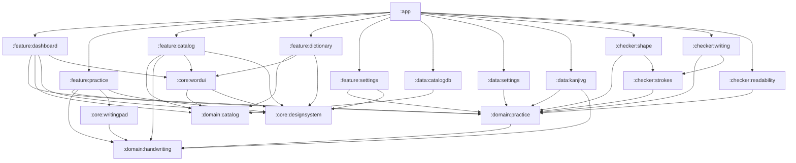

# Архитектура приложения

Документ описывает действующее архитектурное устройство проекта «Кандзи дэс нэ», границы модулей и правила взаимодействия между слоями.

---

## 1. Базовые принципы

1. **Обязательная многоязычность (Russian-First)**:
   Приложение создаётся прежде всего для русскоязычной аудитории. Русский язык — основной язык интерфейса и резервный язык (fallback) при отсутствии переводов. Переводимые данные отделены от сущностей предметной области и помечаются тегом `language_tag`. Подробнее: [правила локализации](implementation/localization.md).
2. **Clean Architecture**:
   - **Presentation** (`:feature:*`) — отображение, управление состоянием экрана (UDF), обработка пользовательских действий.
   - **Domain** (`:domain:*`) — чистые модели данных, сценарии, бизнес-правила и абстракции (интерфейсы). Чистый Kotlin/JVM без Android-зависимостей, Compose, Room и сторонних библиотек.
   - **Data и Checkers** (`:data:*`, `:checker:*`) — адаптеры и реализации: локальные базы данных (Room), хранилище настроек (DataStore), чтение эталонов SVG, алгоритмы распознавания и геометрической проверки.
   - Направление зависимостей строго ориентировано к **Domain**.
3. **Модульность по фичам и слоям**:
   - Прямые зависимости между feature-модулями (`feature` $\to$ `feature`) **запрещены**.
   - Общий UI выносится в `:core:*`.
   - Внутренние детали реализации модулей скрываются модификатором `internal`.
4. **Атомарность виджетов (Compose & Material 3)**:
   - Компоненты интерфейса принимают состояние и передают события наверх через лямбда-колбэки.
   - Виджеты не содержат внутри себя ViewModel, обращения к репозиториям или навигацию.
5. **Dependency Injection**:
   - Принцип DI реализуется через конструкторы.
   - Граф зависимостей собирается вручную на уровне приложения (`KanjiApplication` и `MainActivity`). Использование глобальных Service Locator запрещено.
6. **Стабильный технологический стек**:
   - Используются только официальные стабильные релизы AndroidX, Compose и Kotlin.
   - Применение Experimental/Preview API запрещено без предварительного разрешения и фиксации в [реестре experimental API](decisions/experimental-api.md).
   - Никакого legacy: Fragments, XML-разметка экранов, LiveData и RxJava исключены.

---

## 2. Структура модулей

Проект разделён на 19 модулей с чётким распределением ответственности:

```text
:app                          Точка входа, общая навигация, сборка графа зависимостей

--- Presentation (Feature) ---
:feature:dashboard            Главный экран: прогресс, сводка словаря, выбор тренировки
:feature:practice             Экран рукописной тренировки кандзи, подсказки, таймер
:feature:catalog              Каталог: учебники, главы, списки кандзи, ключей и слов, фильтры
:feature:dictionary           Личный словарь: создание, редактирование и удаление своих слов
:feature:settings             Экран настроек приложения и параметров проверки

--- Domain ---
:domain:practice              Правила тренировки, контракт настроек и интерфейс чекеров
:domain:handwriting           Геометрия штрихов, точки, контракт проверки рукописного ввода
:domain:catalog               Модели каталога, фасетные фильтры, правила дедупликации, словарь

--- Core (UI и системные компоненты) ---
:core:designsystem            Общая тема, базовая палитра, типографика и стили
:core:writingpad              Поле рукописного ввода (PAD) и отображение штрихов
:core:wordui                  Переиспользуемые карточки слов, списки и форма редактора

--- Data (Хранилище и адаптеры) ---
:data:catalogdb               Room: каталог, личный словарь, рецепты и хранение тренировок
:data:settings                Preferences DataStore: хранение параметров проверки
:data:kanjivg                 Загрузчик эталонных изображений кандзи из ассетов KanjiVG

--- Checkers (Проверка написания) ---
:checker:shape                Проверка геометрического сходства формы кандзи (Kotlin/JVM)
:checker:writing              Проверка порядка и направления штрихов (Kotlin/JVM)
:checker:readability          Проверка читаемости через ML Kit Digital Ink (Android)
:checker:strokes              Общие алгоритмы нормализации координат и сравнения линий
```

---

## 3. Граф зависимостей



---

## 4. Ключевые архитектурные решения

### 4.1. Проверка рукописного ввода (три независимых чекера)
Проверка начертания объединяет три независимых анализатора за общим интерфейсом `KanjiChecker`:
1. **Форма (`:checker:shape`)**: проверяет геометрию линий, компенсации и обязательные крючки.
2. **Порядок и направление (`:checker:writing`)**: оценивает правильность траектории каждого штриха.
3. **Читаемость (`:checker:readability`)**: распознаёт кандзи с помощью ML Kit Digital Ink Recognition.

Общие алгоритмы сопоставления черт вынесены в `:checker:strokes`, чтобы исключить дублирование логики и прямую связь между чекерами. Подробнее: [архитектурное решение о трёх чекерах](decisions/three-checkers.md).

### 4.2. Каталог и личный словарь
- Каталог предоставляет иммутабельный снимок данных (`CatalogSnapshot`), который кэшируется в репозитории приложения. Все фильтры, фасеты и поиск вычисляются в памяти на фоновом диспетчере.
- Личный словарь использует реактивный `Flow<List<CatalogWord>>` из Room и транзакционные операции создания, редактирования и архивации слов.
- База данных (`learning.db`) автоматически устанавливается из `seed/catalog.json` с проверкой SHA-256 и версионированием. Подробнее: [каталог](implementation/catalog.md) и [личный словарь](implementation/personal-dictionary.md).
- Масштабирование снимка (paging / SQL-страницы) отложено до явных триггеров: [навигация и масштаб каталога](decisions/navigation-and-catalog-scale.md).

### 4.3. Навигация и состояние
- Верхний уровень в `:app` — корневой type-safe `NavHost` (`AppDestinations.kt`) со стеком `navigate` / `popBackStack`.
- Внутри фичей (каталог, словарь, конструктор рецептов) — nested `NavHost`; PRACTICE → checker settings — соседний маршрут корневого стека (`Practice` / `PracticeChecker`), не второй хост и не boolean-overlay.
- Состояния экранов переживают смену конфигурации и уничтожение процесса через `SavedStateHandle`; `ActiveTraining` остаётся in-memory с resume из Room на PRACTICE.
- Deep links хабов: custom scheme `kanji://mobui/...` ([AppDeepLinks](../app/src/main/java/ru/mobui/kanji/AppDeepLinks.kt)); paging каталога и App Links отложены: [навигация и масштаб каталога](decisions/navigation-and-catalog-scale.md).
