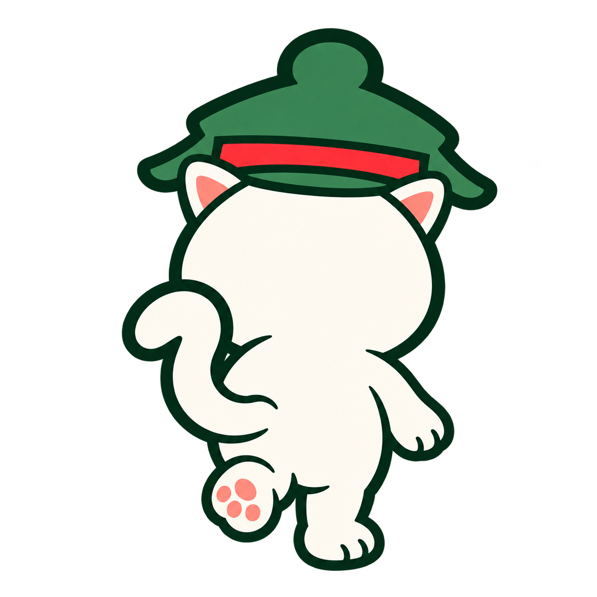
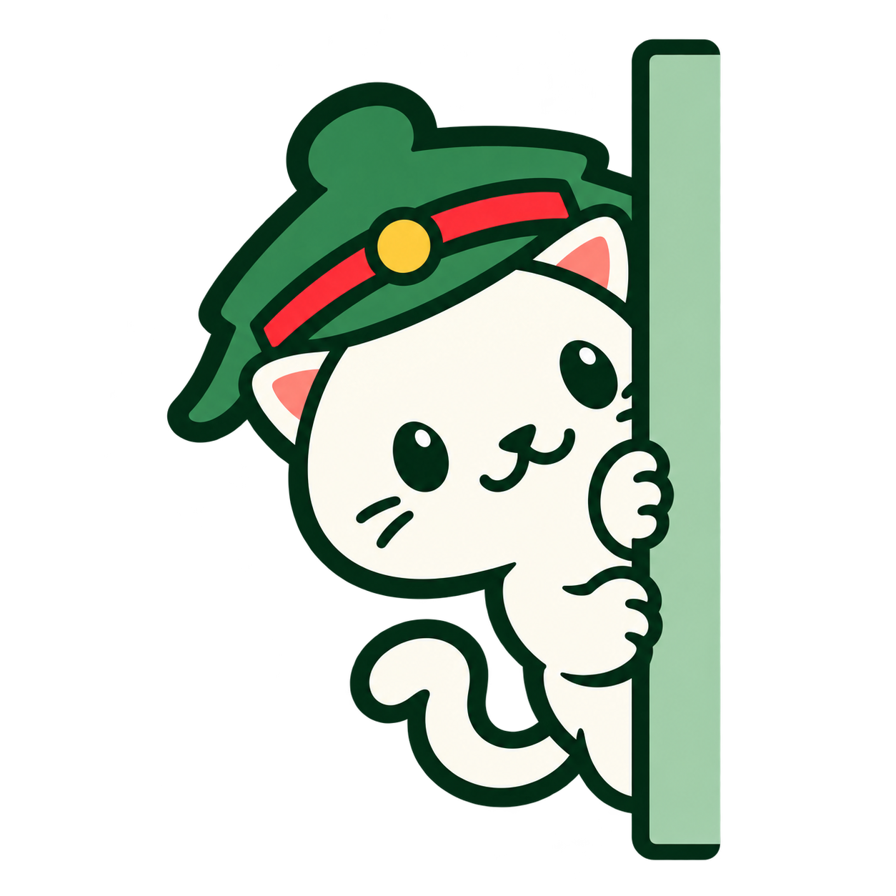
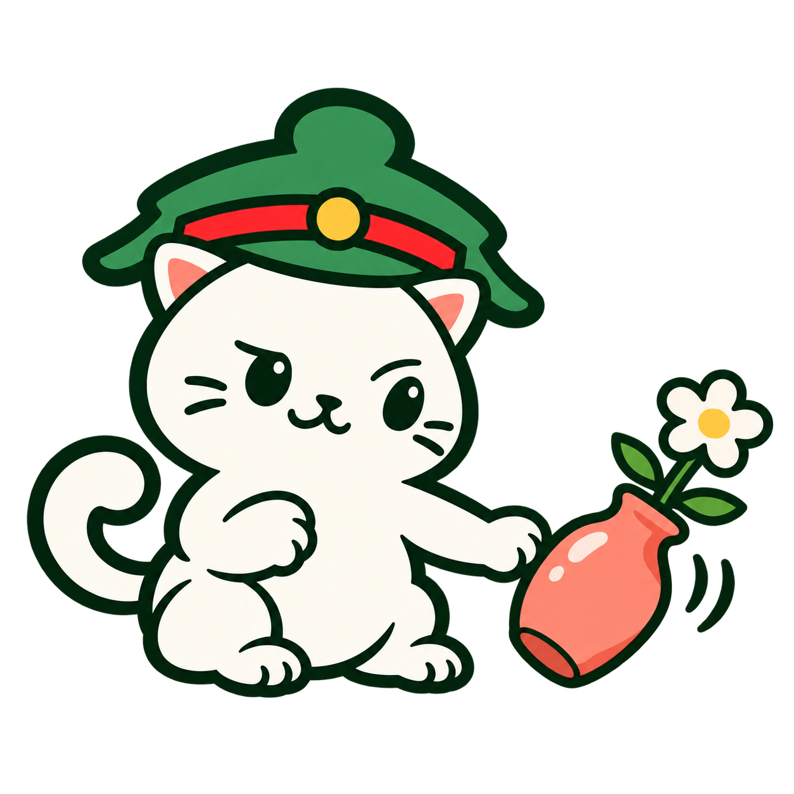
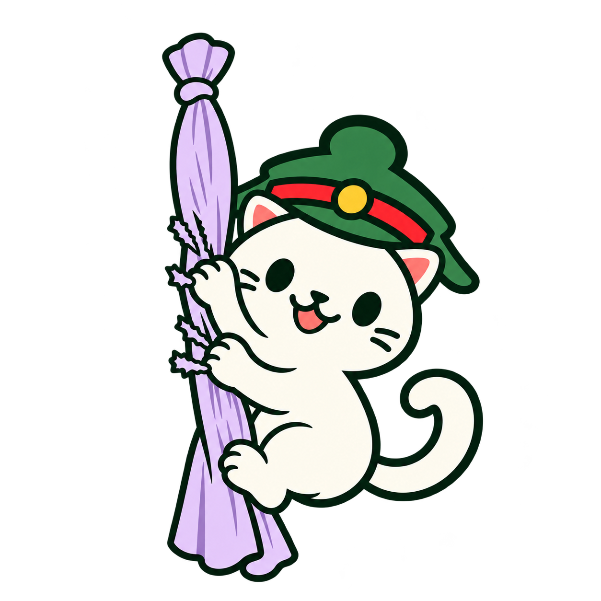
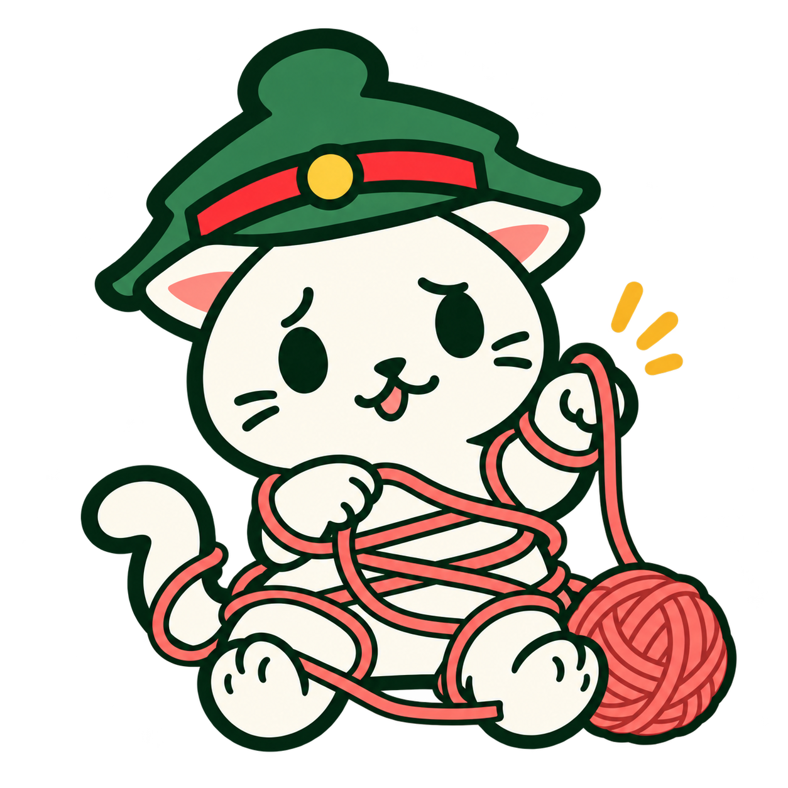
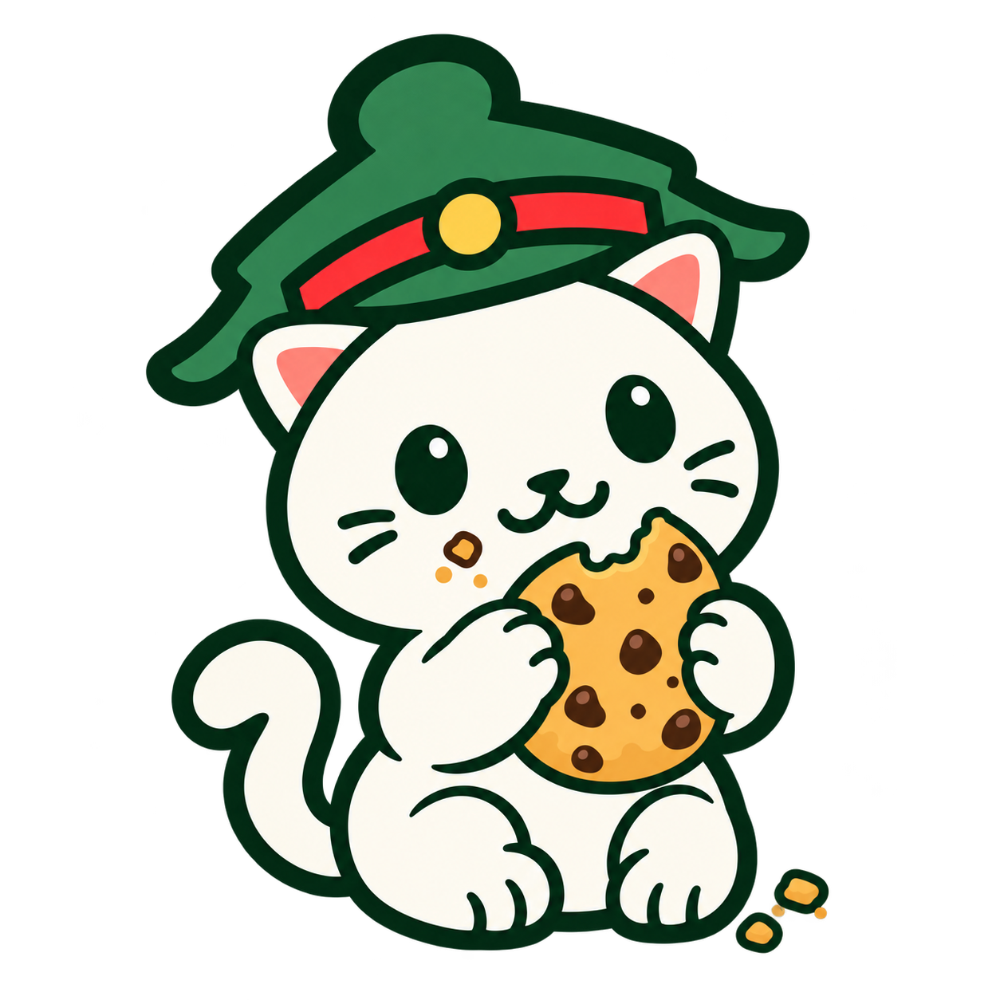
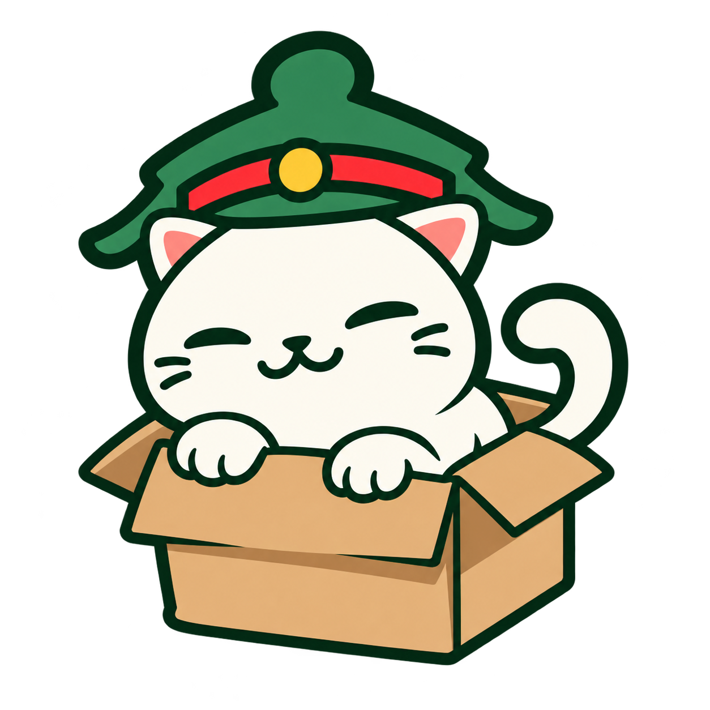

# Стикеры кота-маскота — забавные сценки

21 октября 2026. Второй набор из восьми отдельных иллюстраций. Созданы встроенным `image_gen` по [приветствию](../mascot-stickers/wave.png) и [размышлению](../mascot-stickers/think.png) первого набора: сохранены персонаж, зелёная ученическая шапка с красной полосой и кокардой, палитра и контур.

| Ресурс | Сюжет |
| --- | --- |
| `mascot_sticker_walk_away` | Уходящий кот, вид сзади |
| `mascot_sticker_peek_corner` | Выглядывает из-за угла |
| `mascot_sticker_drop_vase` | Только что столкнул вазу |
| `mascot_sticker_scratch_curtain` | Дерёт штору |
| `mascot_sticker_tangled_yarn` | Запутался в пряже |
| `mascot_sticker_caught_cookie` | Пойман с надкушенным печеньем |
| `mascot_sticker_paper_plane` | Запускает бумажный самолётик |
| `mascot_sticker_tiny_box` | Втиснулся в слишком маленькую коробку |

Каждый стикер хранится отдельным прозрачным PNG в `core/designsystem/src/main/res/drawable-nodpi/`, доступен через `ru.mobui.kanji.core.designsystem.R.drawable.mascot_sticker_*`. Исходники сохранены в этой папке, полные промпты — [prompts.json](prompts.json), сведения о размерах и прозрачности — [manifest.json](manifest.json).

Сюжетные предметы являются частью стикера; сцены не имеют фоновой подложки. Текста на картинках нет. Смысловые описания при использовании на экранах локализуются (русский основной); декоративным изображениям задаётся `contentDescription = null`.

## Просмотр

| Уходит | Выглядывает | Роняет вазу | Дерёт штору |
| --- | --- | --- | --- |
|  |  |  |  |

| Пряжа | Печенье | Самолётик | Коробка |
| --- | --- | --- | --- |
|  |  |  |  |

[Первый набор: эмоции и позы](../mascot-stickers/README.md).

Проверка: все восемь новых PNG имеют альфа-канал и прозрачные поля без обрезки. Набор собран вместе с первым: все 16 отдельных ресурсов найдены в debug APK. Сборка приложения и lint дизайн-системы успешны.

## Исправления после просмотра

- Ваза: полка удалена, кот слева лапой опрокидывает вазу справа; действие читается по наклону и контакту лапы.
- Коробка: задняя лапа через стенку удалена; стенка целая, видны только передние лапы на верхнем крае и хвост над открытым верхом.
- Штора: в ресурсах одна исправленная версия с узелком и прозрачным полем сверху.

Предыдущие варианты сохранены отдельно в `revisions/`, в приложение включены только актуальные. Промпты исправлений: [revision-prompts.json](revision-prompts.json).

[Третий набор: учёба и отдых](../mascot-stickers-study/README.md).
