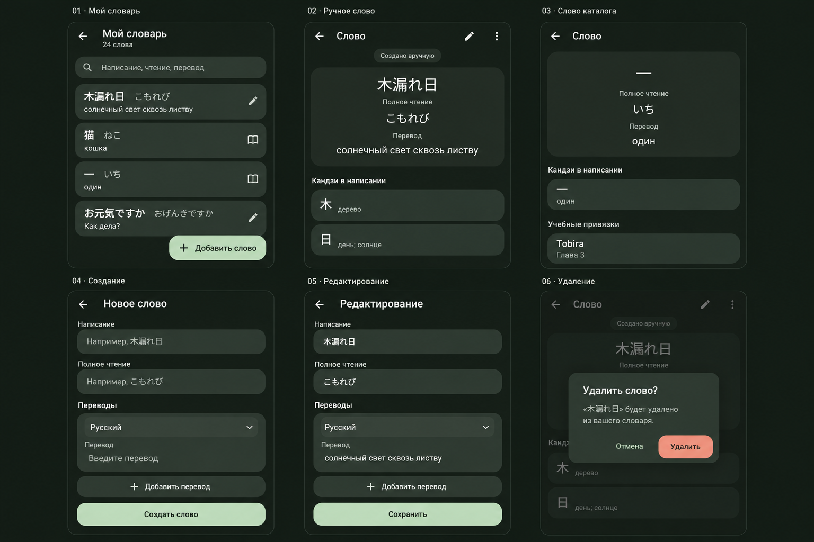

# Макеты «Мой словарь», v1

21 октября 2026 года. Концепт, не снимки приложения.

Список, ручное слово, слово каталога, создание, редактирование, удаление. Общая карточка и общая форма. Менять и удалять можно только ручные слова. Значки происхождения в списке — предложение оформления, не отдельные кнопки.

Сгенерировано встроенным image_gen. Референс: catalog-refined-dark-word-card.png.

## Промпт

Use case: ui-mockup. Create a polished high resolution UI design board for the Russian Android kanji learning app, using the supplied screenshot as a STYLE REFERENCE, not an edit target. One landscape board with SIX equal-sized tall phone screen mockups arranged in a clean 3-column by 2-row grid. All six screens fully visible, large enough for readable Russian type, no device hardware, perspective or decorative illustrations. Dark green outer board and app background #172019; information cards #242C25, interactive cards #303B33; pale cream text, muted sage secondary text, light sage primary buttons. Material 3, rounded cards 24dp, 20dp content margins. Match the reference’s restrained typography and flat tonal surfaces. No gradients, no outlines around cards, no arrows on list rows. Compact but comfortably spaced Android UI.

Above each screen place a small external numbered caption. Screens:
1 caption "01 · Мой словарь". App toolbar back arrow and title "Мой словарь", subtitle "24 слова". Search pill "Написание, чтение, перевод". Rounded word rows with written form and reading on one line, translation below: "木漏れ日   こもれび" / "солнечный свет сквозь листву"; "猫   ねこ" / "кошка"; "一   いち" / "один"; "お元気ですか   おげんきですか" / "Как дела?". A subtle small pencil icon identifies manually created words, a small book icon identifies catalog words. Floating extended bottom-right button "+ Добавить слово".
2 caption "02 · Ручное слово". Toolbar "Слово" with back arrow, pencil edit action and overflow dots. Small subdued chip "Создано вручную". Same word summary layout as reference, center aligned: "木漏れ日", label "Полное чтение", "こもれび", label "Перевод", "солнечный свет сквозь листву". Below heading "Кандзи в написании", actionable rows "木  дерево" and "日  день; солнце". No textbook bindings for this manual word.
3 caption "03 · Слово каталога". Toolbar "Слово" with back arrow ONLY, no edit and no overflow action. Same identical summary component as screen 2 with "一", "Полное чтение", "いち", "Перевод", "один". Below "Кандзи в написании" row "一  один", then "Учебные привязки" row "Tobira" / "Глава 3". Catalog word is strictly read only.
4 caption "04 · Создание". Toolbar back arrow, "Новое слово". Full width tonal editable fields with labels "Написание" and placeholder "Например, 木漏れ日", label "Полное чтение" and placeholder "Например, こもれび". Heading "Переводы". Translation editor rounded card: language selector "Русский" with small down chevron, multiline field label "Перевод", placeholder "Введите перевод". Text button "+ Добавить перевод". Bottom full-width button "Создать слово". No keyboard displayed.
5 caption "05 · Редактирование". Same reusable form EXACTLY as screen 4, toolbar "Редактирование", filled values "木漏れ日", "こもれび", language "Русский", translation "солнечный свет сквозь листву". Same "+ Добавить перевод". Bottom button "Сохранить". No keyboard displayed.
6 caption "06 · Удаление". Show manual word details dimmed behind a centered Android alert dialog with heading "Удалить слово?", text "«木漏れ日» будет удалено из вашего словаря.", horizontal buttons "Отмена" and "Удалить", destructive button muted coral. Underlying overflow menu need not be visible.

Constraints: Russian wording accurate, Japanese glyphs accurate, consistent common components between screens. This board presents the same detail screen for personal and catalog words, with actions enabled ONLY for manually created words; creation/editing visibly share a single form design. No training buttons, no favorites, no extra navigation tabs, no invented features.

